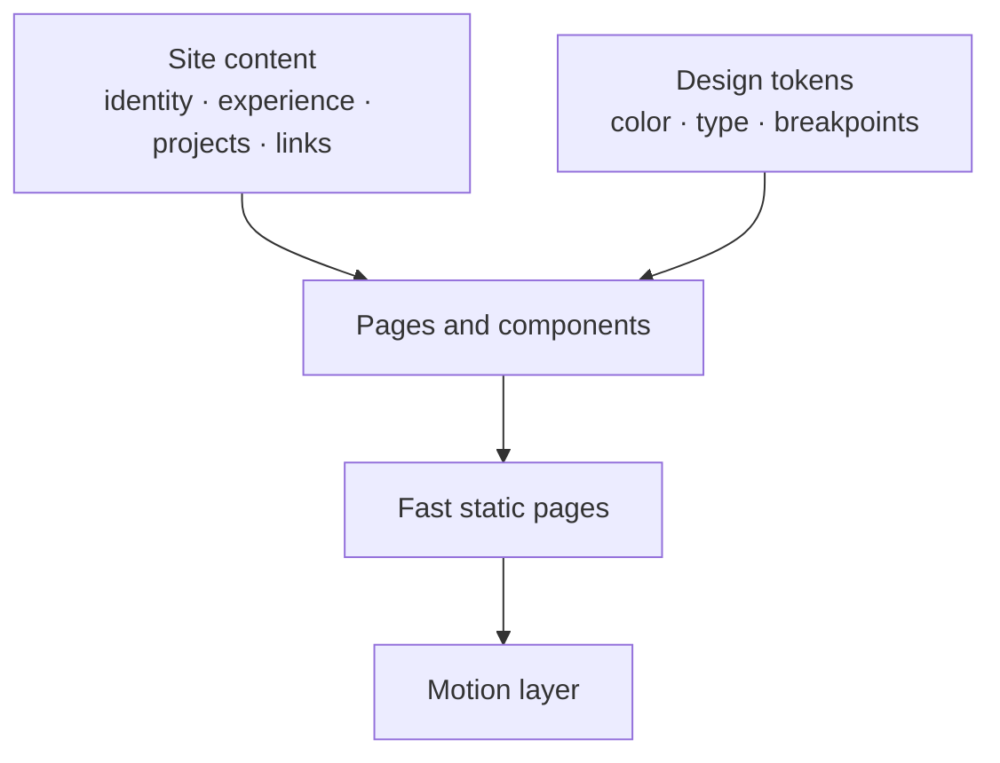

  

<h1 align="center">Portfolio</h1>

<strong>My personal portfolio at davishiggins.com: a motion-led, editorial home for my work, experience, and the projects I build across data, AI, and the web.</strong>

  &nbsp;
  &nbsp;
  

Live · Built by Davis Higgins

---

## See it in motion

  

Real capture of the live site: home scroll scene, then the Work route. <a href="assets/demo.png">Static frame</a>

## What it does

- **An identity first.** A full-width animated wave field and an oversized name set the tone before any copy appears. The header carries location, a contrast toggle, social links, and a résumé link.
- **The work, organized.** A Work route presents each project with its category, a short description, the tools behind it, and a link to the live product. Portfolio and Domains pages map everything I run across the web.
- **Me, briefly.** About and Contact routes cover experience, current roles, and the fastest ways to reach me.

## Why I built it

I wanted a portfolio that feels designed, not templated, and that can grow as fast as my project list does. It needed room for analytics work, client websites, and AI systems without forcing them all into one generic card.

## What I built

- **A multi-route site:** Work, About, Contact, Portfolio, and Domains pages with route heroes and a project grid
- **Custom components:** the project grid, an interactive cursor trail, flip-text links, running-line dividers, a systems section, and a closing footer
- **A single content layer** for my identity, experience, skills, projects, and links, so updates never touch layout
- **My brand throughout:** navy and Carolina Blue, the DH mark, and a header verse typewriter
- **Content carried over** from earlier versions of davishiggins.com, including projects, experience, and the full link ecosystem

<strong>How it's put together</strong>

 

| Decision | Why |
|---|---|
| **Static first** | Pages ship as plain HTML and load JavaScript only where motion needs it, so the site stays fast even with heavy visual effects. |
| **Content separate from layout** | Adding a project is a content change, not a component edit. |
| **One token system** | Colors, type, and breakpoints come from one source, so the contrast theme switches cleanly across every page. |

## Screens

<table>
  <tr>
    <td width="62%"></td>
    <td rowspan="2" width="38%" align="center"></td>
  </tr>
  <tr>
    <td></td>
  </tr>
</table>

Homepage · Work · Homepage on mobile

## Technology

| Layer | Technology |
|---|---|
| Framework | Astro, TypeScript |
| Styling | Sass, CSS custom properties |
| Motion | GSAP, Lenis, canvas and WebGL effects |
| Hosting | Vercel |

---

  &nbsp;
  

© 2026 Davis Higgins. Site foundation adapted from AW-2025-Portfolio by Antoine Wodniack (CC BY-NC 4.0).

