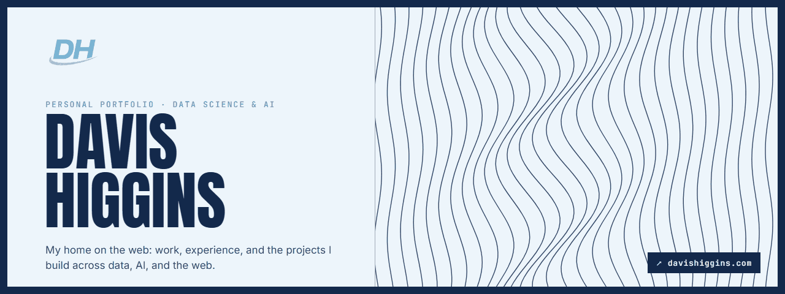
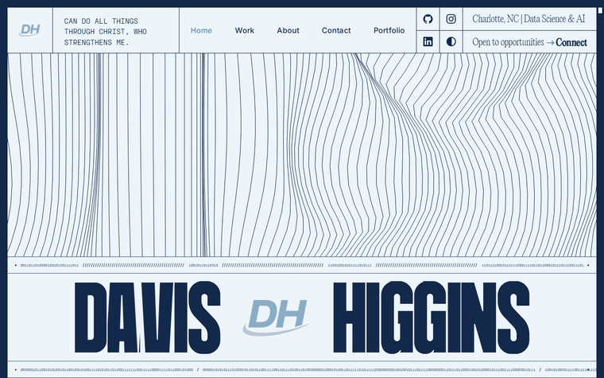
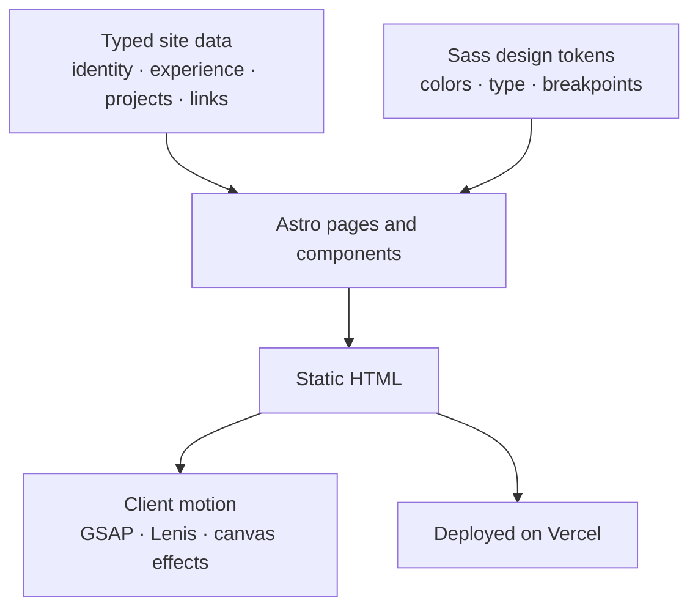
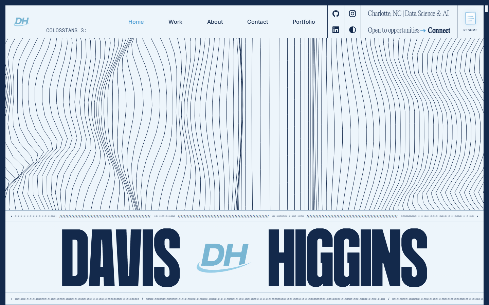
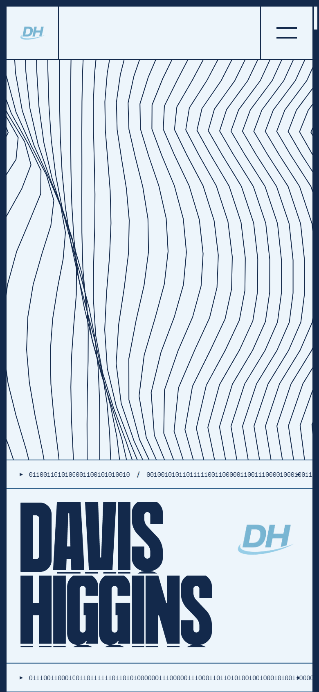
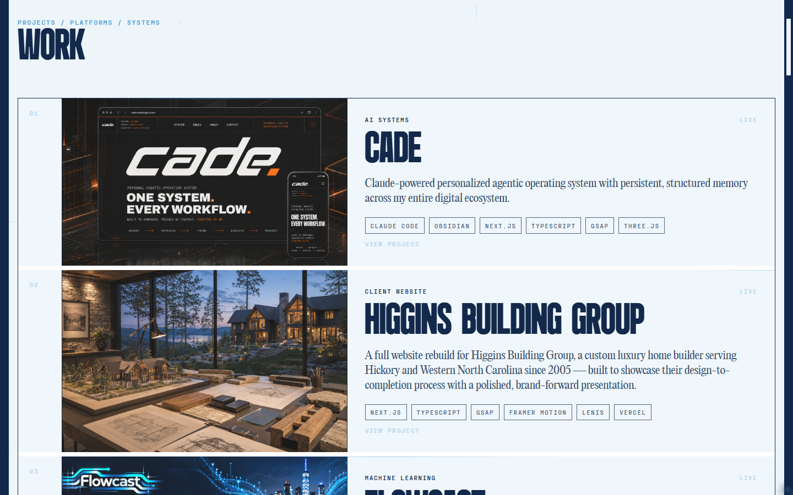

  

<h1 align="center">davishiggins.com</h1>

  <strong>My personal portfolio: a motion-led, editorial site for my work, experience, and the projects I build across data, AI, and the web.</strong> 
  <a href="https://davishiggins.com"><strong>Visit davishiggins.com ↗</strong></a> · <a href="https://davishiggins.com/work">Work</a> · <a href="https://www.higginsd.com/work/davishiggins-com">Case study</a>

Live · Adapted and extended by Davis Higgins from an open-source portfolio (credited below) · Separate from the conversational <a href="https://portfolio.davishiggins.com">DH Portfolio</a>

---

## See it in motion

  

Real capture of the live site after its preloader: home scroll scene, then the Work route. <a href="assets/demo.png">Static frame</a>

## What it does

- **An identity first.** A full-width animated wave field and an oversized name set the tone before any copy appears. The header carries location, a contrast toggle, social links, and a résumé link.
- **The work, organized.** A Work route presents each project with its category, a short description, the tools behind it, and a link to the live product. Portfolio and Domains pages map everything I run across the web.
- **Me, briefly.** About and Contact routes cover experience, current roles, and the fastest ways to reach me, with a running verse in the header that reflects what matters to me.

## Why I built it

I wanted a portfolio that feels designed, not templated, and that can grow as fast as my project list does. The site needed room for analytics work, client websites, and AI systems without forcing them into one generic card style.

## Built on open source, then extended

This site starts from [AW-2025-Portfolio](https://github.com/AntoineW/AW-2025-Portfolio) by Antoine Wodniack, released under [CC BY-NC 4.0](https://creativecommons.org/licenses/by-nc/4.0/). That project supplied the Astro foundation, the homepage composition, and its motion approach.

What I built on top of it:

- **A multi-route site.** New Work, About, Contact, Portfolio, and Domains pages, with route heroes and a project grid driven by my own data
- **New components,** including the project grid, an interactive cursor trail, flip-text links, running-line dividers, a systems section, and a closing footer
- **A data layer** that keeps my identity, experience, skills, projects, and links in one typed module, so copy changes don't touch components
- **My own brand applied throughout:** navy and Carolina Blue, the DH mark, and a header verse typewriter
- **Content migrated** from the previous version of davishiggins.com, including projects, experience, and the full link ecosystem

## How it's put together

### Engineering decisions

| Decision | Why |
|---|---|
| **Astro for a content site** | Pages render to static HTML and ship JavaScript only where motion needs it. A portfolio stays fast even with heavy visual effects. |
| **Content separated from layout** | Projects, experience, and links live in a single data module that every route reads. Adding a project is a data change, not a component edit. |
| **Tokens over one-off styles** | Colors, type families, and breakpoints are Sass maps compiled to CSS custom properties, with a contrasted theme defined from the same map. The contrast toggle swaps one class instead of restyling every component. |

My own components check `prefers-reduced-motion` before running their effects.

## Screens

<table>
  <tr>
    <td width="62%"></td>
    <td rowspan="2" width="38%" align="center"></td>
  </tr>
  <tr>
    <td></td>
  </tr>
</table>

Homepage · Work · Homepage on mobile

## Technology

| Layer | Technology | Responsibility |
|---|---|---|
| Framework | Astro 5, TypeScript | Static pages and components |
| Styling | Sass, CSS custom properties | Tokens, themes, layout |
| Motion | GSAP, Lenis, canvas and WebGL effects | Scroll scenes, wave field, cursor trail |
| Hosting | Vercel | Deployment |

## Notes

- **Distinct from DH Portfolio.** [portfolio.davishiggins.com](https://portfolio.davishiggins.com) is a separate project: a conversational portfolio you ask questions of. This repository covers davishiggins.com only.
- **Earlier versions.** Earlier versions of davishiggins.com were built in Next.js with Three.js scenes. The live site described here is the current Astro build.
- **Typography in this repository.** The cover graphic uses free stand-in fonts and doesn't redistribute the site's licensed typefaces.

## About this repository

This is a documentation-only showcase. The site's source isn't included here.

**[Visit davishiggins.com ↗](https://davishiggins.com)** · Built by Davis Higgins · [More of my work](https://github.com/DavisHiggins)

© 2026 Davis Higgins. Text and images in this repository are shared for portfolio viewing, non-commercially. The site is adapted from AW-2025-Portfolio by Antoine Wodniack (CC BY-NC 4.0), with changes as described above.
